# TermicGuard — Documentación técnica

Monitorización de temperatura en tiempo real para una flota de nodos ESP32.
Este documento explica **cómo está hecho el software**: su arquitectura, su
modelo de datos, sus protocolos y las decisiones que explican por qué está
hecho así y no de otra forma.

> `README.md` es la guía de uso (cómo levantarlo y manejarlo).
> `CLAUDE.md` es la guía para modificarlo con seguridad.
> **Este documento es la referencia de diseño.**

Todos los diagramas están en Mermaid, así que se renderizan solos en GitHub,
GitLab, VS Code (extensión *Markdown Preview Mermaid*) y Obsidian.

---

## Índice

1. [Visión general](#1-visión-general)
2. [Mapa del repositorio](#2-mapa-del-repositorio)
3. [Arquitectura de software](#3-arquitectura-de-software)
4. [Arquitectura de red](#4-arquitectura-de-red)
5. [Arquitectura de despliegue](#5-arquitectura-de-despliegue)
6. [Modelo de datos](#6-modelo-de-datos)
7. [Contrato MQTT](#7-contrato-mqtt)
8. [API REST](#8-api-rest)
9. [Diagramas temporales](#9-diagramas-temporales)
10. [Máquinas de estado](#10-máquinas-de-estado)
11. [Arquitectura del cliente Flutter](#11-arquitectura-del-cliente-flutter)
12. [Métricas: qué se mide y cómo](#12-métricas-qué-se-mide-y-cómo)
13. [Decisiones de diseño](#13-decisiones-de-diseño)
14. [Operación y diagnóstico](#14-operación-y-diagnóstico)

---

## 1. Visión general

El sistema tiene **cuatro capas** y un principio que las atraviesa: *el
tiempo real y la persistencia son caminos independientes*. Si la base de
datos se cae, el dashboard sigue mostrando temperaturas; si el dashboard se
cierra, la ingesta sigue guardando.

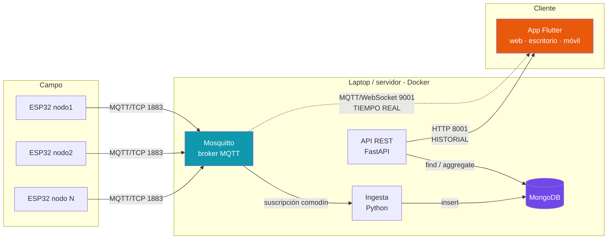

| Capa | Qué hace | Dónde vive |
|------|----------|------------|
| **Firmware** | Publica dos temperaturas simuladas cada 5 s en JSON | `arduino_ide/sensor/sensor.ino` |
| **Broker** | Encamina mensajes; dos listeners (TCP y WebSocket) | `infra/mosquitto/` |
| **Backend** | `ingesta` persiste; `api` sirve lectura | `infra/servicios/` |
| **Cliente** | Dashboard multiplataforma | `lib/` |

**La línea de puntos es la clave del diseño.** La app no consulta la base de
datos para ver el tiempo real: se suscribe al broker directamente. La base de
datos solo aporta el histórico del arranque y la vista de datos.

---

## 2. Mapa del repositorio

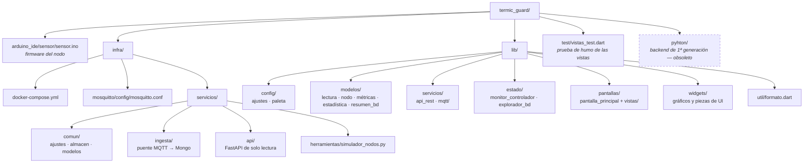

`pyhton/` (con la errata en el nombre) es el backend original por HTTP. Está
**completamente superado** por `infra/` y nadie lo referencia.

---

## 3. Arquitectura de software

### 3.1 Componentes y responsabilidades

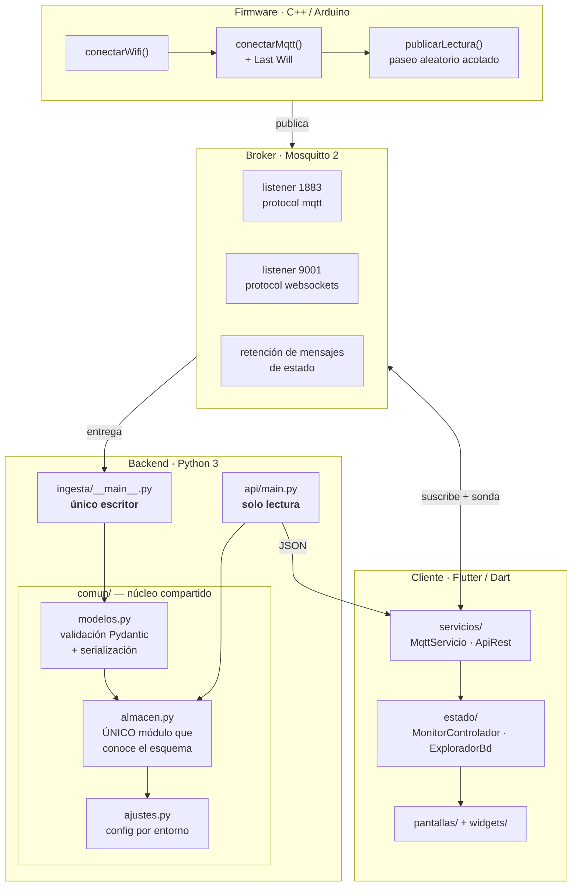

**Regla de oro del backend:** `ingesta` es el único proceso con permiso de
escritura. `api` nunca escribe. Eso elimina de raíz las carreras entre
escritores y hace que el esquema solo pueda cambiar desde un sitio
(`almacen.py`).

### 3.2 Capas del cliente

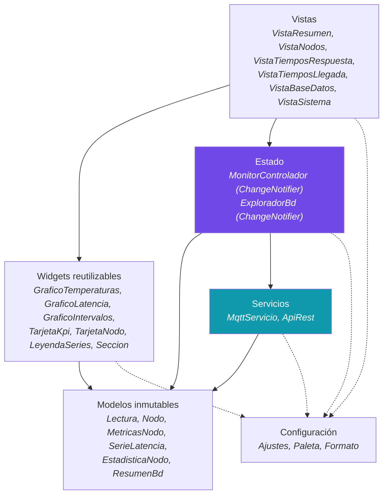

Las flechas van en un solo sentido: **ninguna capa inferior conoce a la
superior**. Un servicio no sabe que existe una vista; un modelo no sabe que
existe un controlador. Por eso el mismo `MonitorControlador` alimenta seis
vistas distintas sin cambiar una línea.

### 3.3 Modelo de clases del cliente

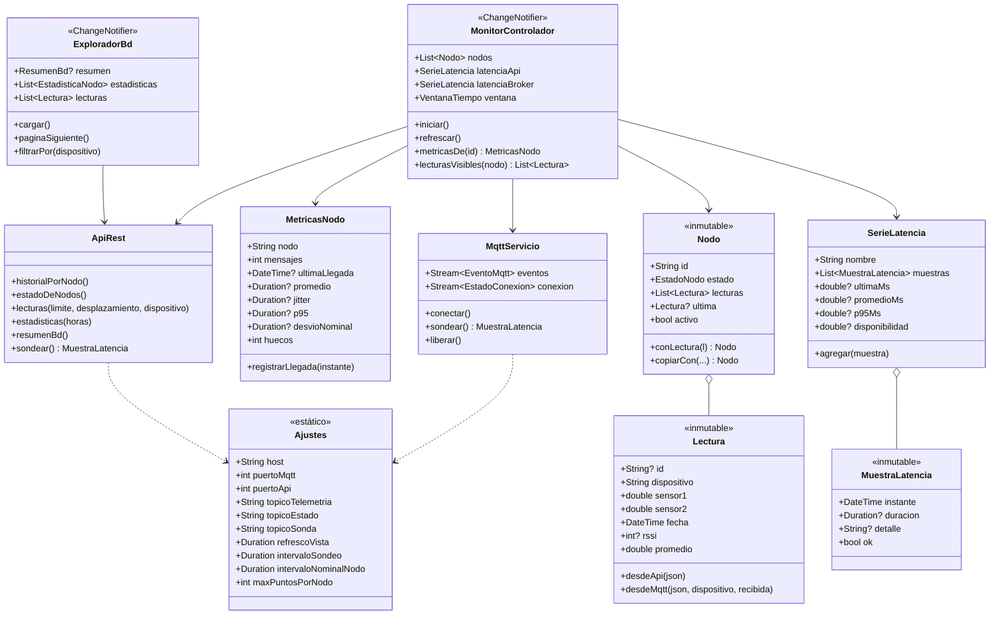

---

## 4. Arquitectura de red

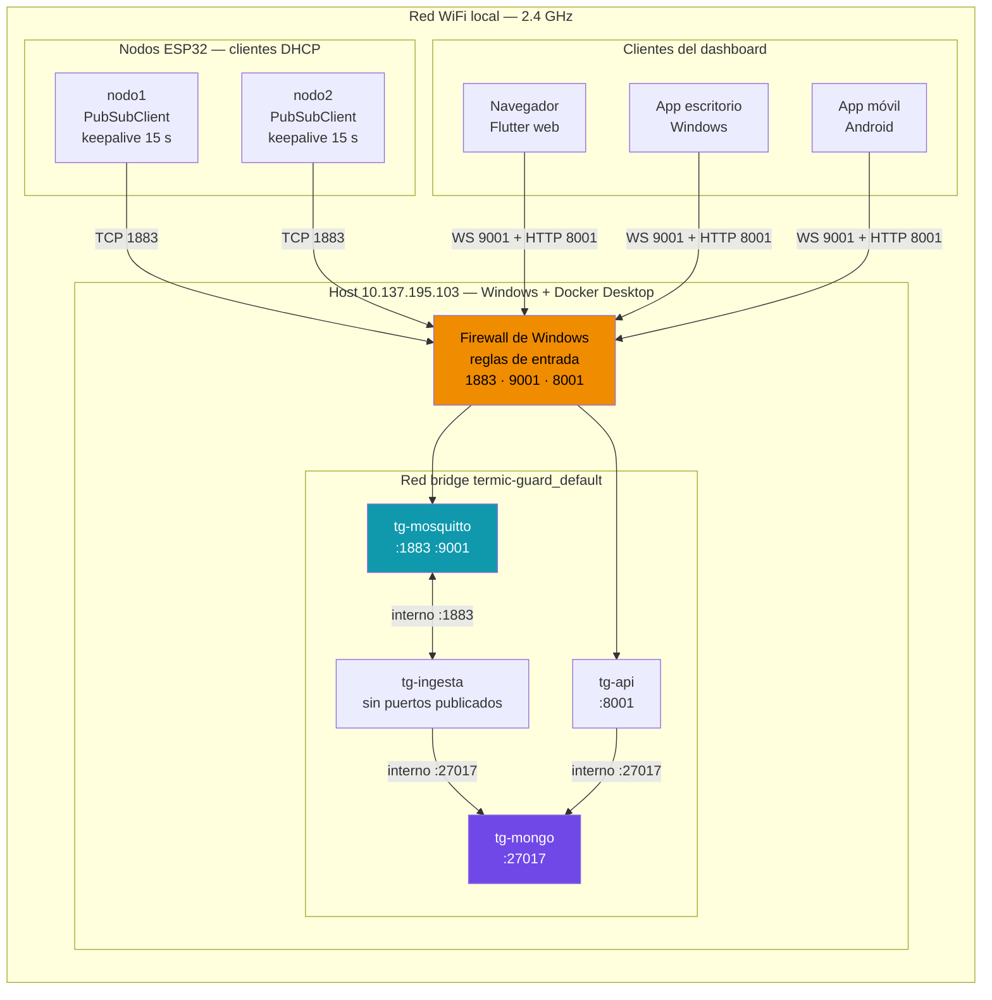

### Puertos

| Puerto | Protocolo | Quién lo usa | Publicado al host |
|--------|-----------|--------------|-------------------|
| `1883` | MQTT sobre TCP | ESP32 | Sí |
| `9001` | MQTT sobre WebSocket | App Flutter (todas las plataformas) | Sí |
| `8001` | HTTP / REST | App Flutter, navegador, `curl` | Sí |
| `27017` | Wire protocol de MongoDB | MongoDB Compass | Sí |

**Dos listeners porque son dos protocolos.** Un navegador no puede abrir un
socket TCP; está obligado a usar WebSocket. Para no mantener dos caminos de
código en la app, **todas** las plataformas usan WebSocket — la elección de
implementación la hace `lib/servicios/mqtt/fabrica_cliente.dart` con una
exportación condicional sobre `dart.library.js_interop`.

### Por qué el firewall aparece en el diagrama

Es el fallo más frecuente del sistema. Desde el propio host todo funciona
(`localhost` no atraviesa el firewall), así que el síntoma típico es "en mi
PC va pero en el móvil no". Las tres reglas de entrada son obligatorias.

---

## 5. Arquitectura de despliegue

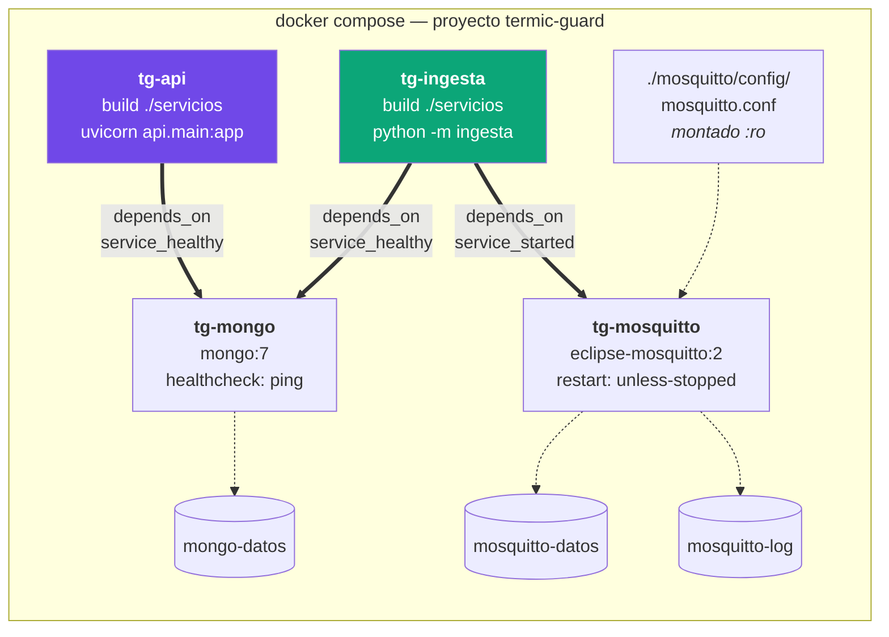

**Una imagen, dos entrypoints.** `ingesta` y `api` se construyen del mismo
`infra/servicios/Dockerfile` y solo difieren en el `command`. Comparten el
paquete `comun/`, de modo que el modelo de datos no puede divergir entre el
que escribe y el que lee.

**El orden de arranque importa.** `ingesta` espera a que Mongo esté *healthy*
(no solo arrancado) y además reintenta 30 veces en `esperar_mongo()`. Con
Mosquitto basta `service_started`: si el broker aún no acepta, paho reintenta
solo con backoff de 1 a 16 s.

---

## 6. Modelo de datos

### 6.1 Diagrama entidad-relación

MongoDB no es relacional, pero la relación lógica entre las dos colecciones
es exactamente esta:

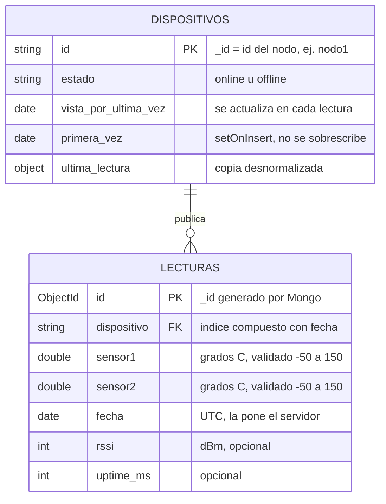

### 6.2 Documentos reales

```javascript
// colección: lecturas
{
  _id:         ObjectId("6ae26925df4b9f131eb1e9d8"),
  dispositivo: "nodo1",
  sensor1:     38.2,
  sensor2:     40.6,
  fecha:       ISODate("2026-10-28T21:29:09.240Z"),  // UTC, del servidor
  rssi:        -51,
  uptime_ms:   1843210
}

// colección: dispositivos   (_id = id del nodo ⇒ upsert idempotente)
{
  _id:                   "nodo1",
  estado:                "online",
  vista_por_ultima_vez:  ISODate("2026-10-28T21:29:09.240Z"),
  primera_vez:           ISODate("2026-10-22T01:13:45.912Z"),
  ultima_lectura: { sensor1: 38.2, sensor2: 40.6,
                    fecha: ISODate("2026-10-28T21:29:09.240Z") }
}
```

### 6.3 Índices y por qué existen

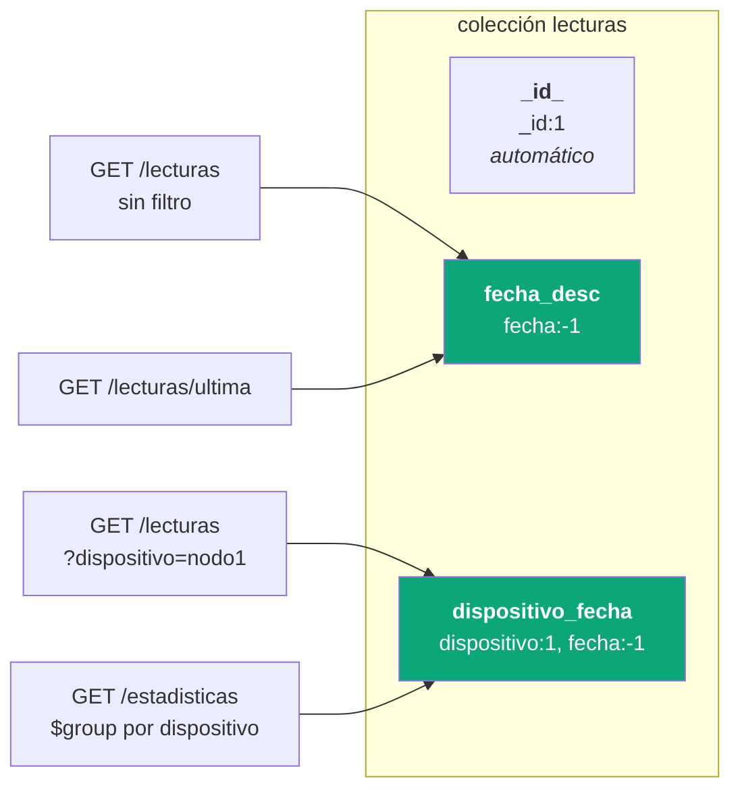

| Índice | Consulta que cubre |
|--------|--------------------|
| `fecha_desc` | historial global ordenado por fecha descendente |
| `dispositivo_fecha` | historial de un nodo concreto y la agregación por nodo |

Sin `dispositivo_fecha`, filtrar por nodo obligaría a un *collection scan*
completo y la vista de base de datos se degradaría a medida que crece la
serie. `asegurar_indices()` es idempotente y se llama en cada arranque de
los dos servicios.

### 6.4 Por qué `dispositivos` desnormaliza la última lectura

`ultima_lectura` duplica datos que ya están en `lecturas`. Es deliberado: el
endpoint `/dispositivos` responde el estado de toda la flota con **una sola
lectura de dos documentos**, sin tocar la serie temporal. El coste de la
duplicación es un `$set` extra por inserción; el beneficio es que el panel de
estado no depende del tamaño del historial.

---

## 7. Contrato MQTT

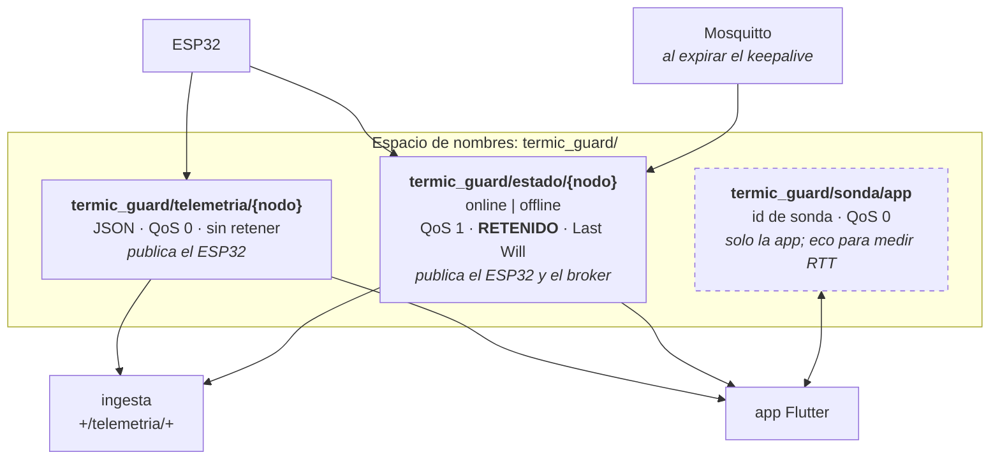

### Payload de telemetría

```json
{
  "dispositivo": "nodo1",
  "sensor1": 38.2,
  "sensor2": 40.6,
  "rssi": -51,
  "uptime_ms": 1843210
}
```

**No lleva fecha, y es a propósito.** El ESP32 no tiene reloj de tiempo real:
cualquier fecha que enviara sería inventada. La fecha autoritativa la pone
`ingesta` al persistir (`ahora_utc()`), y para la vista en vivo la app usa la
hora de llegada del mensaje.

### Tres reglas que no se pueden romper

1. **La identidad viene del tópico, no del payload.** `ingesta` sobrescribe
   `payload["dispositivo"]` con el segmento del tópico antes de validar. Un
   nodo mal configurado no puede escribir en la serie de otro.
2. **Suscripción con comodín, sin registro de nodos.** Todo el sistema usa
   `termic_guard/telemetria/+`. Añadir un ESP32 es encenderlo: aparece solo.
3. **Los tres strings están duplicados** en firmware (C++), backend (Python)
   y cliente (Dart) por necesidad del lenguaje. Si cambia uno, cambian los
   tres.

### QoS: por qué cada tópico lleva el suyo

| Tópico | QoS | Razón |
|--------|-----|-------|
| telemetría (ESP32 → broker) | 0 | Llega una lectura cada 5 s; reintentar una perdida no aporta y gasta batería y RAM del nodo |
| telemetría (broker → ingesta) | 1 | La ingesta sí debe recibir todo; con `clean_session=False` el broker le guarda los mensajes si se reinicia |
| estado / LWT | 1 + retenido | Un cliente que se conecta después debe enterarse igual del último estado conocido |
| sonda | 0 | Mide el camino rápido; un reintento falsearía la medición |

---

## 8. API REST

Base: `http://10.137.195.103:8001` · Documentación interactiva: `/docs`

| Método | Ruta | Parámetros | Devuelve |
|--------|------|-----------|----------|
| `GET` | `/` | — | Estado del servicio y de la conexión a Mongo |
| `GET` | `/lecturas` | `limite` (1-1000), `dispositivo`, `desplazamiento` | Lecturas **más reciente primero** |
| `GET` | `/lecturas/total` | `dispositivo` | `{"total": n}` para paginar |
| `GET` | `/lecturas/ultima` | `dispositivo` | Última lectura registrada |
| `GET` | `/dispositivos` | — | Nodos conocidos y su estado |
| `GET` | `/estadisticas` | `horas` (1-8760) | Agregados por nodo calculados por Mongo |
| `GET` | `/bd/resumen` | — | Colecciones, documentos, tamaño e índices |

**`/lecturas` devuelve de más nueva a más antigua y el cliente lo invierte**,
porque las gráficas necesitan tiempo creciente mientras que una consulta de
historial quiere lo último primero. `Nodo.lecturas` siempre va de antigua a
reciente. Cambiar cualquiera de los dos extremos rompe las gráficas en
silencio.

CORS está abierto (`allow_origins=["*"]`, solo `GET`) porque Flutter web se
sirve desde otro origen. Es un perfil de LAN; para exponerlo fuera hay que
restringirlo y quitar el acceso anónimo del broker.

---

## 9. Diagramas temporales

### 9.1 Camino completo de una lectura

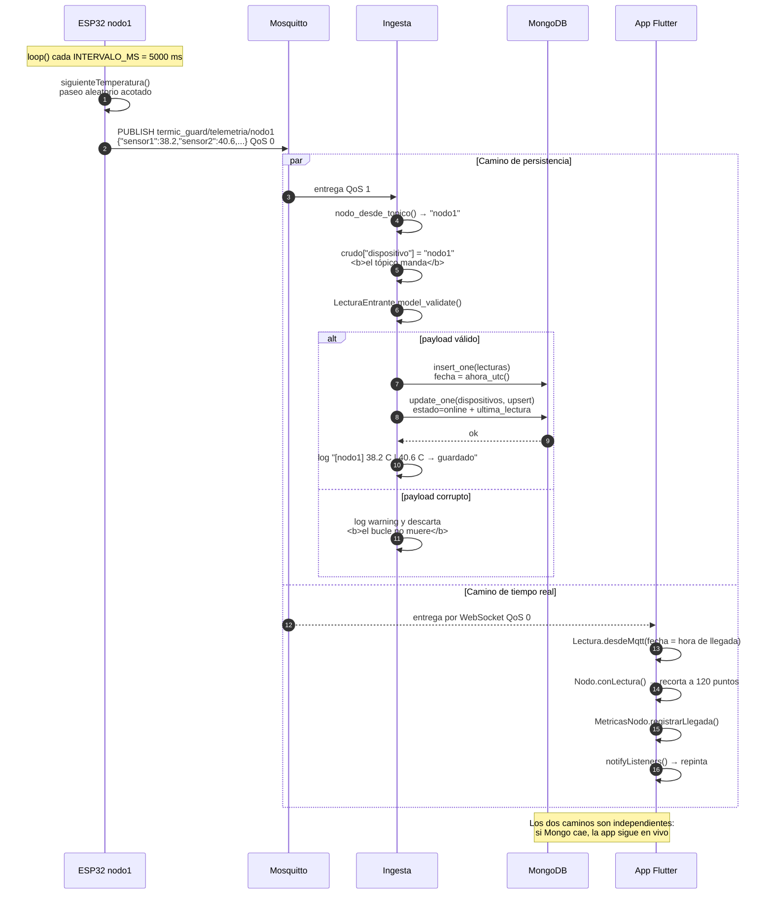

### 9.2 Arranque de la aplicación

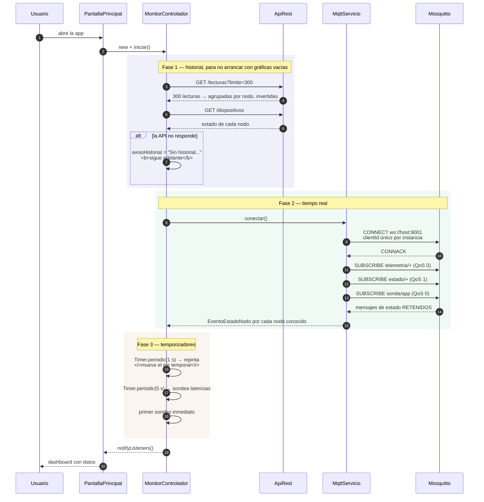

### 9.3 Medición de latencias

Las dos sondas se lanzan en paralelo para que midan el mismo instante y una
lenta no retrase a la otra.

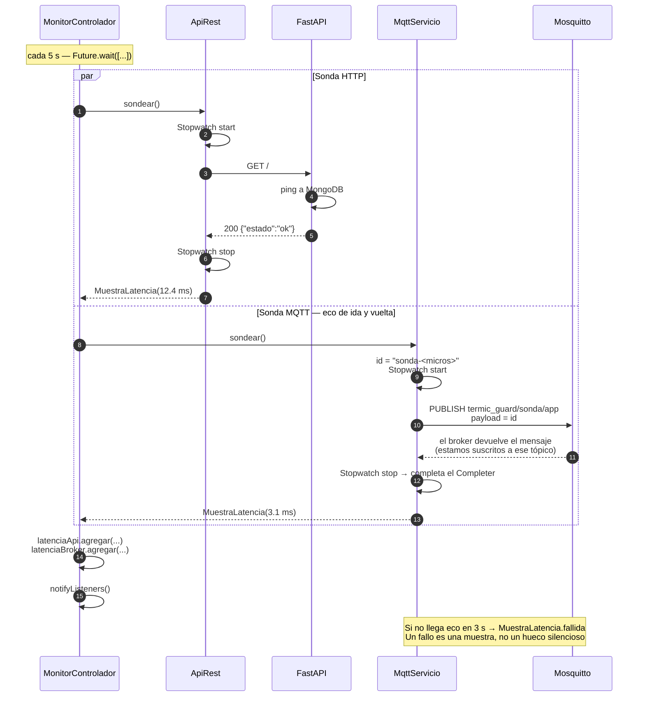

**Por qué el eco y no un ping de protocolo.** El RTT medido así atraviesa
exactamente el mismo camino que una lectura real: WebSocket, encolado en
Mosquitto y entrega al suscriptor. Un `PINGREQ` de MQTT mediría solo la capa
de transporte y no detectaría un broker con las colas saturadas.

### 9.4 Caída de un nodo

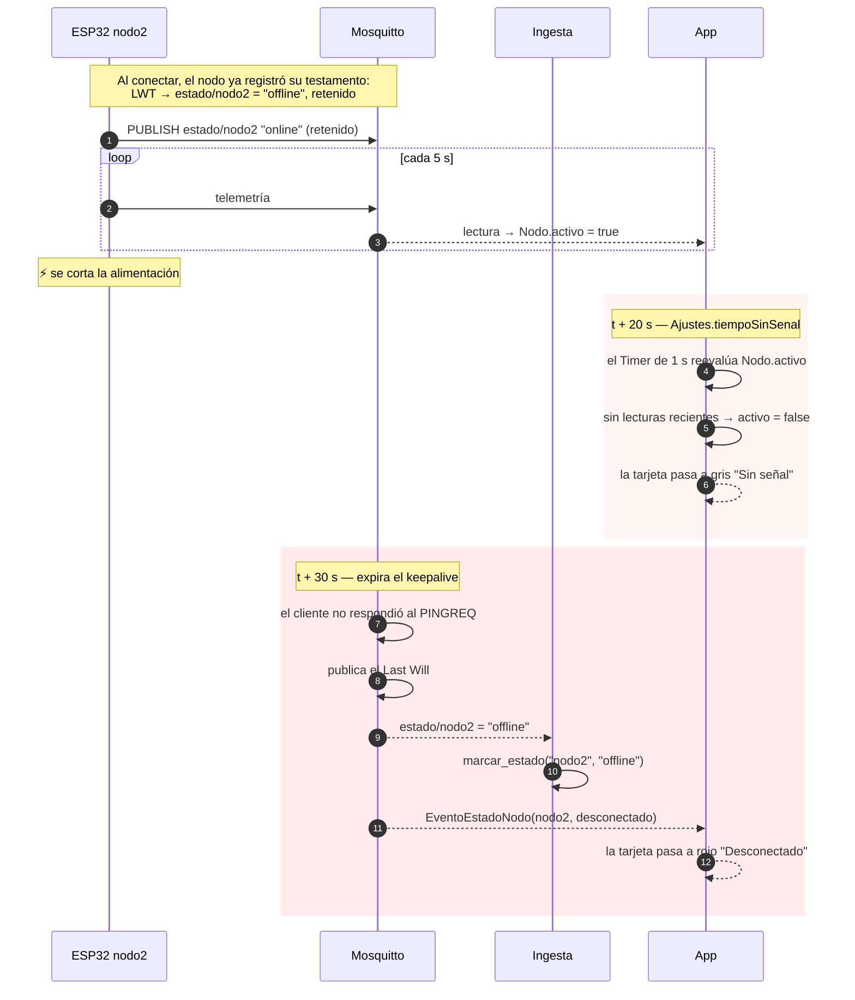

**Los dos umbrales son distintos a propósito** y por eso el dashboard tiene
tres estados y no dos: hay una ventana de ~10 s en la que la app ya sabe que
algo va mal (*Sin señal*) pero el broker todavía no lo ha confirmado
(*Desconectado*). Esa ventana es información útil, no un bug.

---

## 10. Máquinas de estado

### 10.1 Vitalidad de un nodo

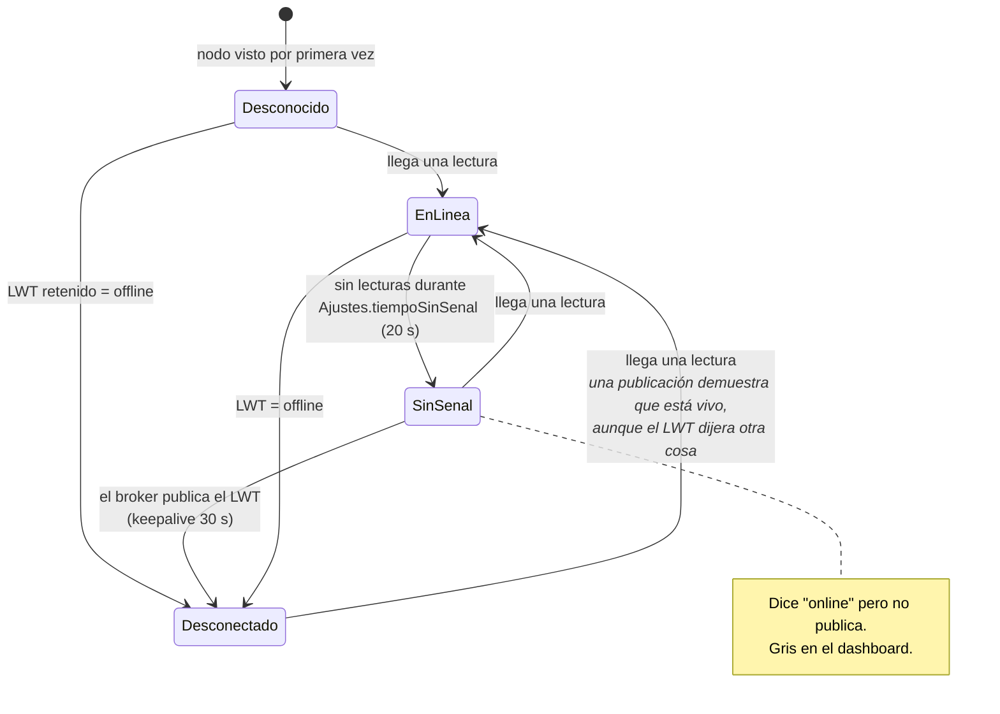

La vitalidad son **dos señales, no una**: `dispositivos.estado` (el LWT) y la
frescura de la última lectura. `Nodo.activo` exige las dos; `Paleta.deNodo()`
y `Paleta.etiquetaDeNodo()` pintan el resultado de tres valores.

### 10.2 Enlace MQTT del cliente

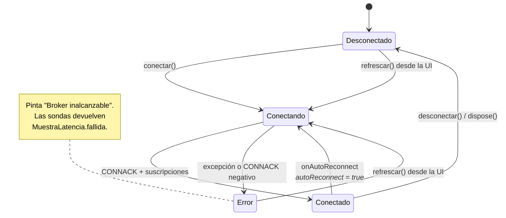

### 10.3 Ciclo de vida del firmware

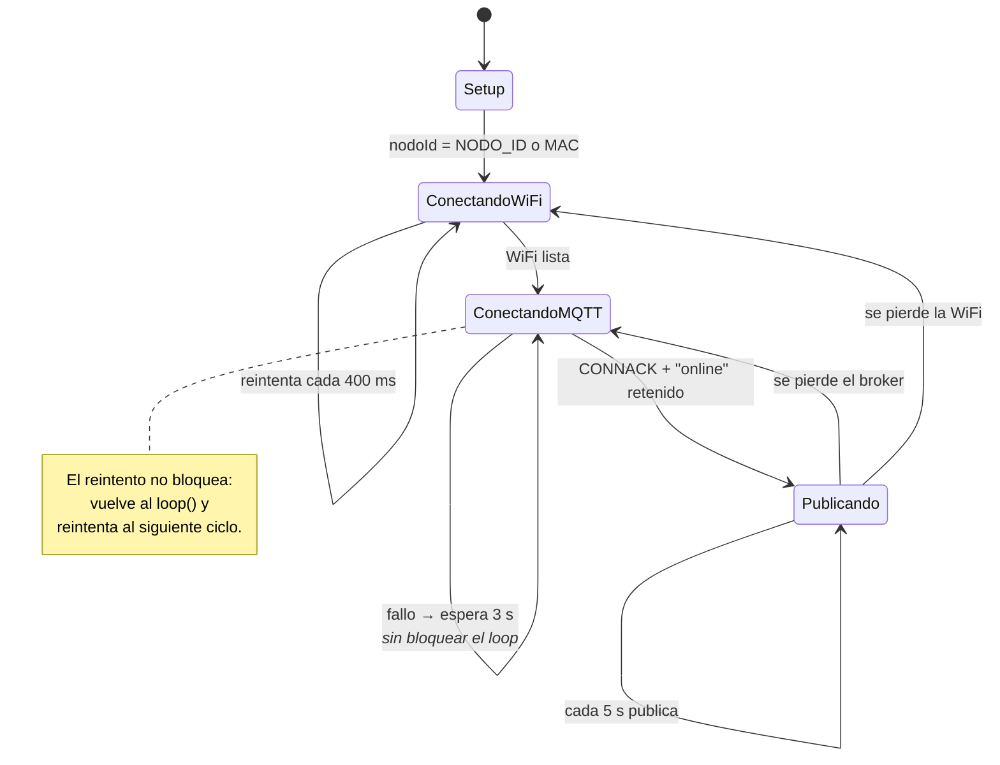

---

## 11. Arquitectura del cliente Flutter

### 11.1 Navegación

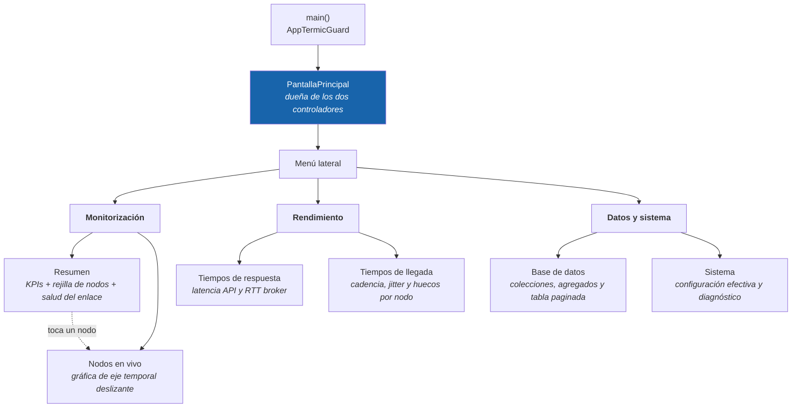

**Adaptación por ancho:** ≥1000 px menú extendido con texto · ≥760 px menú de
iconos · por debajo, cajón lateral (*drawer*) con botón hamburguesa.

**Los controladores viven en `PantallaPrincipal`, no en las vistas.** Cambiar
de pestaña no reconecta el broker ni pierde el histórico acumulado: las seis
vistas son lecturas distintas del mismo estado.

### 11.2 Flujo de datos y repintado

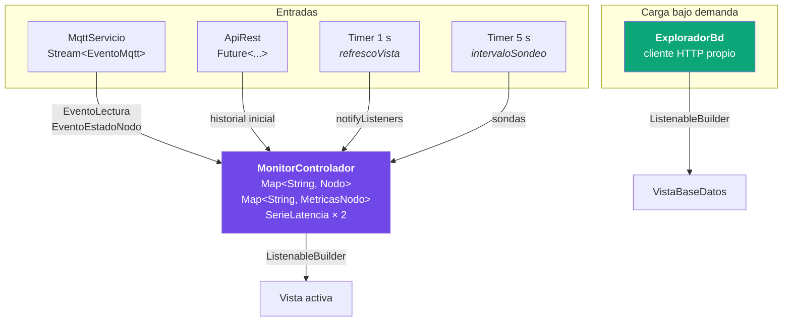

**Por qué el repintado a 1 Hz.** La gráfica tiene el eje X anclado a `ahora`:
sin un tick periódico, la ventana solo avanzaría cuando llegara una lectura y
un nodo caído dejaría la gráfica congelada en lugar de mostrar el hueco
creciendo. El mismo tick reevalúa `Nodo.activo` y los "hace N s".

**Por qué `ExploradorBd` está separado.** Una consulta a Mongo no puede
bloquear el tiempo real ni refrescarse a 1 Hz. Se carga la primera vez que se
abre su vista y se queda quieta hasta que el usuario pide otra página. Usa su
propio cliente HTTP para que una consulta lenta no ocupe la conexión que usa
el monitor para sondear.

### 11.3 Memoria acotada

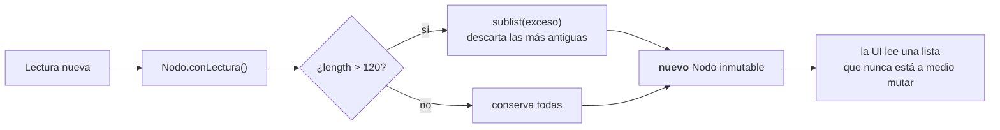

| Estructura | Límite | Constante |
|------------|--------|-----------|
| Lecturas por nodo | 120 puntos | `Ajustes.maxPuntosPorNodo` |
| Muestras de latencia | 120 por serie (≈10 min) | `Ajustes.maxMuestrasLatencia` |
| Intervalos por nodo | 60 huecos | `Ajustes.maxIntervalosPorNodo` |

Con 10 nodos la app estabiliza en unos pocos MB y no crece con el tiempo de
ejecución. `Nodo` es inmutable y se reemplaza entero en cada evento, así que
la UI nunca lee una lista a medio modificar.

---

## 12. Métricas: qué se mide y cómo

### 12.1 Tiempos de respuesta

| Métrica | Definición | Dónde se calcula |
|---------|-----------|------------------|
| **Latencia API** | `GET /` completo, incluido el ping a Mongo | `ApiRest.sondear()` |
| **RTT broker** | PUBLISH → eco del broker al mismo cliente | `MqttServicio.sondear()` |
| **p95** | Percentil 95 de la ventana de 120 muestras | `SerieLatencia.percentil()` |
| **Disponibilidad** | `(muestras − fallos) / muestras × 100` | `SerieLatencia.disponibilidad` |

Umbrales de color, calibrados para LAN (`Paleta.deLatencia`):

| Rango | Estado |
|-------|--------|
| < 150 ms | Buena |
| 150–500 ms | Lenta |
| ≥ 500 ms o sin respuesta | Crítica |

**Un fallo es una muestra.** Si una sonda no responde se guarda como
`MuestraLatencia.fallida` y deja un hueco visible en la gráfica. Descartarla
bajaría la latencia media justo cuando el sistema va peor.

### 12.2 Tiempos de llegada

```mermaid
flowchart LR
    M1["mensaje n-1<br/>t = 10.00 s"] -->|"hueco"| M2["mensaje n<br/>t = 15.08 s"]
    M2 --> D["intervalo = 5.08 s"]
    D --> N{"¿> 1.8 × nominal?<br/>(> 9 s)"}
    N -->|sí| H["cuenta como <b>hueco</b><br/><i>probable pérdida: QoS 0 no reintenta</i>"]
    N -->|no| OK["intervalo normal"]
```

| Métrica | Qué delata |
|---------|-----------|
| **Media** | El ritmo real frente al nominal de 5 s del firmware |
| **Desvío nominal** | `media − 5 s`. Positivo = el nodo va lento |
| **Jitter** | Desviación media absoluta. Alto = la red entrega a ráfagas aunque la media parezca bien |
| **p95** | El hueco que sufre 1 de cada 20 mensajes |
| **Huecos** | Intervalos > 1,8 × nominal ⇒ mensajes perdidos |

**Solo cuenta el tráfico en vivo.** El historial que viene de la API lleva la
fecha que puso el servidor al persistir, no la de llegada a la app; mezclar
las dos falsearía los intervalos. Por eso `MetricasNodo.registrarLlegada()`
se invoca únicamente desde el flujo MQTT.

### 12.3 Agregados de la base de datos

`GET /estadisticas` ejecuta un `$group` **en el servidor**, no en el cliente:

```javascript
[
  { $match: { fecha: { $gte: desde } } },        // opcional, parámetro horas
  { $group: {
      _id: "$dispositivo",
      lecturas:     { $sum: 1 },
      sensor1_min:  { $min: "$sensor1" },
      sensor1_max:  { $max: "$sensor1" },
      sensor1_prom: { $avg: "$sensor1" },
      // ... ídem sensor2 y rssi
      primera:      { $min: "$fecha" },
      ultima:       { $max: "$fecha" }
  }},
  { $sort: { _id: 1 } }
]
```

`intervalo_medio_s = (ultima − primera) / (lecturas − 1)`: el periodo real de
publicación medido sobre lo persistido.

> **Estos números no coinciden con los del dashboard, y está bien.** La app
> guarda 120 puntos por nodo; Mongo agrega sobre la serie completa. El máximo
> de `/estadisticas` es el máximo histórico real; el de la vista de nodos es
> el de la ventana que estás mirando.

---

## 13. Decisiones de diseño

Cada una resuelve un problema concreto. Cambiarlas sin entender el problema
rompe algo que hoy funciona.

| # | Decisión | Problema que resuelve |
|---|----------|----------------------|
| 1 | **Dos caminos de datos** (MQTT en vivo + REST histórico) | Mongo o la API caídos no deben apagar el dashboard. Degrada a "solo en vivo, con banda de aviso" |
| 2 | **Siempre WebSocket**, también en escritorio y móvil | El navegador no puede usar TCP. Un solo listener y un solo camino de código para las cuatro plataformas |
| 3 | **Suscripción con comodín, sin registro de nodos** | Añadir un ESP32 no requiere configurar nada en ningún sitio |
| 4 | **La identidad viene del tópico** | Un nodo mal configurado no puede contaminar la serie de otro |
| 5 | **La fecha la pone el servidor** | El ESP32 no tiene RTC; cualquier fecha suya sería inventada |
| 6 | **`ingesta` es el único escritor** | Sin carreras entre escritores; el esquema solo cambia desde `almacen.py` |
| 7 | **Ventana deslizante de 120 puntos** | Memoria acotada: la app no crece con el tiempo de ejecución |
| 8 | **`Nodo` inmutable, reemplazado entero** | La UI nunca lee una lista a medio mutar |
| 9 | **Vitalidad = LWT + frescura** | Un nodo puede decir "online" y haber dejado de publicar |
| 10 | **Configuración por `--dart-define` / variables de entorno** | Cambiar de IP no obliga a tocar código |
| 11 | **Eje X temporal, no por índice** | Un nodo que se calla deja un hueco visible en vez de dibujar una línea continua falsa |
| 12 | **Múltiplos pequeños en el resumen** | Una gráfica con N series obligaría a inventar colores cuando entra un nodo nuevo y a repintar los demás cuando uno se cae |
| 13 | **Sonda de eco para el RTT** | Recorre el mismo camino que una lectura real; un `PINGREQ` solo mediría el transporte |
| 14 | **`ExploradorBd` separado del monitor** | Una consulta a Mongo no puede frenar el tiempo real |
| 15 | **Paleta validada para daltonismo** | Las series se distinguen sin depender del color; además siempre hay leyenda y tabla |

### Sobre la paleta

| Uso | Color | Nota |
|-----|-------|------|
| Sensor 1 | `#E8590C` naranja | Par validado: ΔE ≥ 19 en protan/deutan/tritan |
| Sensor 2 | `#1098AD` cian | |
| API REST | `#7048E8` violeta | Par distinto del de temperatura a propósito |
| Broker MQTT | `#0CA678` verde azulado | |
| En línea / alerta / caído | `#2F9E44` / `#F08C00` / `#E03131` | **Reservados**: nunca se usan como color de serie |

Los colores de estado siempre van con icono y etiqueta de texto. El valor
numérico se pinta en color de texto, nunca en el de la serie: quien lleva la
identidad es la marca de color que va al lado.

### Lo que está mal a propósito (perfil de LAN)

- `allow_anonymous true` en Mosquitto: **sin autenticación**.
- CORS abierto en la API.
- MongoDB sin credenciales y con el puerto publicado.

Es un perfil de desarrollo en red local de confianza. Para exponerlo fuera
hacen falta `password_file` en el broker, TLS en los tres puertos,
autenticación en Mongo y CORS restringido.

---

## 14. Operación y diagnóstico

### Levantar y comprobar

```bash
cd infra
docker compose up -d --build
docker compose ps                   # 4 servicios: mosquitto, mongo, ingesta, api
docker compose logs -f ingesta      # cada lectura persistida, en vivo
docker compose down -v              # reinicio total, borra todos los datos
```

```bash
flutter pub get
flutter analyze                     # debe salir limpio
flutter test                        # prueba de humo de las seis vistas
flutter run -d chrome
flutter run -d windows
flutter run --dart-define=TG_HOST=10.0.2.2    # emulador de Android
```

Simulador de nodos, que publica el mismo JSON en los mismos tópicos que el
firmware real:

```bash
python infra/servicios/herramientas/simulador_nodos.py --nodos 3
```

> Si lo lanzas dentro de un contenedor, ese contenedor **sigue vivo** aunque
> interrumpas el comando. Comprueba `docker ps | grep sim` antes de fiarte de
> una prueba de caída: un simulador olvidado mantiene un nodo "online".

### Árbol de diagnóstico

```mermaid
flowchart TD
    S["El dashboard no muestra datos"] --> Q1{"¿Qué dice la<br/>barra superior?"}

    Q1 -->|"Broker inalcanzable"| B1{"¿docker compose ps<br/>muestra 4 servicios?"}
    B1 -->|no| F1["docker compose up -d"]
    B1 -->|sí| B2{"¿Desde otro equipo<br/>de la red?"}
    B2 -->|sí| F2["Firewall: abrir 1883, 9001 y 8001<br/>en el perfil de red actual"]
    B2 -->|no| F3["Comprueba TG_HOST:<br/>¿cambió la IP por DHCP?"]

    Q1 -->|"MQTT en vivo,<br/>0 nodos"| C1{"¿Hay alguien<br/>publicando?"}
    C1 -->|no| F4["Enciende un ESP32 o lanza<br/>simulador_nodos.py"]
    C1 -->|sí| F5["Monitor serie a 115200:<br/>¿sale [mqtt] ok?<br/>rc=-2 ⇒ firewall o IP"]

    Q1 -->|"En vivo pero sin<br/>historial"| D1["La API o Mongo están caídos.<br/>Vista Sistema → fila API REST"]
    D1 --> F6["docker compose logs api"]

    style F2 fill:#F08C00,color:#000
    style F3 fill:#F08C00,color:#000
```

La **vista Sistema** de la app muestra la configuración efectiva de esa
compilación (host, puertos, tópicos y parámetros) con el estado de cada
enlace. Es la primera pantalla que hay que mirar cuando alguien dice "no
conecta": evita adivinar contra qué IP se construyó el binario.

### Cambiar de IP

La app se reapunta sin tocar código:

```bash
flutter run   --dart-define=TG_HOST=192.168.1.50
flutter build web --release --dart-define=TG_HOST=192.168.1.50
```

El firmware sí hay que reflashearlo (`MQTT_HOST` en `sensor.ino`). Si la red
es DHCP, conviene reservar la IP en el router: cuando expira el *lease*, los
nodos dejan de encontrar el broker.

---

*Documento de diseño de TermicGuard. Para uso diario, `README.md`; para
modificar el código con seguridad, `CLAUDE.md`.*
